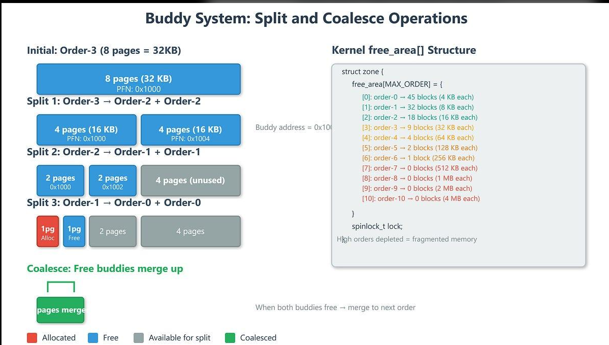

# memarena

[English](#english) · [Русский](#русский)

## English

A library of three allocators on top of memory taken from the system: a cursor in one region (`Bump`), a chain of such regions (`Arena`), and a free-list with size classes (`FreeList`). They share the `Alloc` interface. On top of the free-list sit a shared list under a spinlock, a per-thread magazine, and, behind the `global` feature, a global allocator. Next to them are a fragmentation snapshot and a callsite profiler.

The layout numbers below are for a 64-bit platform, where `usize` is 8 bytes. The block header in `src/freelist.rs` is fixed at compile time by `size_of == 48`.

### Which strategy to use

| Strategy | Individual `free` | Rollback | External fragmentation | Fits when |
| --- | --- | --- | --- | --- |
| `Bump` | no, `deallocate` is empty | `reset`, `rewind` | zero: one free tail | a parser, a frame, a scratch buffer of known size |
| `Arena` | no, `deallocate` is empty | `reset` keeps the newest chunk, `rewind` drops newer chunks | tails of abandoned chunks | a tree, an AST, a graph that dies with its owner |
| `FreeList` | yes, the block returns to a bin | no checkpoint | holes between live blocks until neighbors are free | mixed lifetimes, reuse of blocks |
| `ThreadLocalArena` | same as an arena | `reset` of that thread's arena only | same as an arena | each thread builds its own graph |
| `ThreadCache` | yes | no | same as the free-list | many small allocations from several threads |
| `GlobalFreeList` | yes, through `GlobalAlloc` | no | same as the free-list | replace the process global allocator |

### Quick start

```rust
use memarena::Bump;

let bump = Bump::with_capacity(4096)?;
let value = bump.alloc(41u32)?;
assert_eq!(*value, 41);
```

```rust
use memarena::Arena;

let arena = Arena::new();
let text = arena.alloc_str("node")?;
let nums = arena.alloc_slice_copy(&[1, 2, 3])?;
assert_eq!(text, "node");
assert_eq!(nums, &[1, 2, 3]);
```

```rust
use memarena::FreeList;

let list = FreeList::new();
let mut node = list.alloc_box(String::from("block"))?;
node.push('!');
drop(node); // destructor runs, then the block returns to the list
assert_eq!(list.stats().live_allocations, 0);
```

`?` is `Result<_, AllocError>`. The error means the system refused memory, or the request cannot be placed: an address overflow, an alignment the block cannot satisfy, or, for a bump allocator, the end of the only region.

### Source map

| Module | Role |
| --- | --- |
| `src/lib.rs` | `Alloc`, `AllocError`, the public types |
| `src/layout.rs` | address alignment, size classes, the dangling ZST pointer |
| `src/chunk.rs` | taking a region from `std::alloc` or `std::alloc::System` and returning it |
| `src/bump.rs` | one region, cursor moves only forward |
| `src/arena.rs` | a chain of bump chunks, growth, `reset`, `rewind` |
| `src/freelist.rs` | boundary tags, classes, splitting, coalescing, `FreeBox` |
| `src/stats.rs` | atomic `Meters` and the `AllocStats` snapshot |
| `src/profile.rs` | callsites, a size histogram, a ring log |
| `src/sync.rs` | a spinlock that does not take the system allocator |
| `src/tls.rs` | `ThreadLocalArena`, `SharedFreeList`, `ThreadCache` |
| `src/global.rs` | `GlobalFreeList`, only with `--features global` |

`Bump`, `Arena`, and `FreeList` look the same from the outside. Each has `allocate` / `deallocate` / `stats`, profiling flags, and `profile_report`. The cursor and the lists move through `Cell` and `AtomicUsize`, so allocation takes `&self`. Rollback and reset, where they exist, take `&mut self`.

### The `Alloc` trait

```rust
pub unsafe trait Alloc {
    fn allocate(&self, layout: Layout) -> Result<NonNull<[u8]>, AllocError>;
    unsafe fn deallocate(&self, ptr: NonNull<u8>, layout: Layout);
    fn stats(&self) -> AllocStats;
}
```

An implementation returns a pointer aligned to `layout.align()` and covering `layout.size()` bytes, or `AllocError`. A zero size returns an aligned dangling pointer and leaves the cursor where it is. `deallocate` accepts only the paired pointer from the same allocator value, with the same `Layout`, and only once. Live allocations point at distinct objects.

`AllocError` is an empty error. It covers a refusal from the system, an address overflow, and a request the current policy cannot place. Its `Display` text is the Russian string «не удалось выделить память».

The pointer handed out is a fat `NonNull<[u8]>`: address and length. `allocation_ptr` drops the length and yields the `NonNull<u8>` that `deallocate` wants.

`allocate` is marked `#[track_caller]`. The callsite the profiler sees is the user's line, not an internal function.

### Lifetimes and safety

`Bump::alloc` and `Arena::alloc` return `&mut T` from `&self`. The reference is tied to the borrow of the allocator, and the exclusivity belongs to the fresh object. The allocator itself is only shared-borrowed. Two allocations in a row are legal: they are two different places. `reset` and `rewind` require `&mut self`, so the compiler rejects a rollback while such a reference is still in use.

Raw `deallocate` is `unsafe`. On a bump allocator and an arena the function is empty: those strategies have no individual free. Bytes come back when the cursor is reset, when a checkpoint is restored, or when the owner is dropped. The call does not read the pointer and does not change the counters. On the free-list the same call finds the block and returns it to a bin.

`alloc` on a bump allocator and an arena does not run destructors on `reset`, `rewind`, or `Drop`. The memory is simply marked reusable or returned to the system. A value with `Drop` placed through `alloc` has to be taken apart by hand before the reset, otherwise its destructor never runs. For the free-list, `FreeBox` does that: its `Drop` runs the destructor and then `deallocate`. `mem::forget` on a `FreeBox` suppresses both the destructor and the return of the block. `Drop` of the `FreeList` itself returns the chunks to the system and does not walk live values.

A zero size is handled on its own.

- The dangling pointer's address equals `layout.align()`, and the slice length is 0. The cursor and the chunks stay put. The system allocator does the same.
- `live_allocations` grows by one. `user_bytes` stays the same.
- On a bump allocator and an arena `deallocate` is empty, so that one lives until `reset` or `rewind`. On the free-list the matching `deallocate` brings the counter back down.
- `Bump::alloc` and `Arena::alloc` do not write a ZST into memory. The argument leaves the function's scope, and its destructor runs immediately, inside `alloc`. The reference handed out points at the dangling address. `FreeBox` does the opposite: the value is `forget`ted, and `drop_in_place` on a dangling pointer runs in the wrapper's `Drop`. Every ZST instance is indistinguishable, so the destructor is the same one.
- A ZST allocation does not overwrite the "last block" fields. `realloc_last` after it still refers to the previous non-zero allocation.

An empty `alloc_slice_copy` and an empty `alloc_str` return an empty slice, without calling `allocate` and without incrementing `live_allocations`.

Raw `allocate` does not zero memory. On a bump allocator and an arena those are the region's bytes as the system returned them, plus anything written there before the cursor was rolled back. On the free-list, a debug build fills a free body with `0xDE` when the block is inserted into a bin. The first word of a block that has been in the thread magazine holds the pointer to the next magazine entry. `GlobalAlloc::alloc_zeroed` zeroes only `layout.size()` bytes of the user area.

Interior addresses are built with `with_addr` from the pointer to the start of the region. The derived pointer keeps the provenance of the original allocation.

`Bump`, `Arena`, and `FreeList` are `Send` and not `Sync`: they contain `Cell`. Across threads the free-list sits in a `SpinLock` (`SharedFreeList`, `GlobalFreeList`). `ThreadCache` is `Sync` as well: the magazine lives in TLS, and the shared heap is covered by the spinlock. `ThreadLocalArena` is a marker with no fields. Each thread's arena sits in `thread_local`.

### Where a region comes from

`chunk::allocate` and `chunk::deallocate` are the only boundary with the system.

- `system == false` calls `std::alloc::alloc` / `dealloc`. The block goes through the current `#[global_allocator]`.
- `system == true` calls `std::alloc::System` directly and steps around the global allocator. This path is what the library uses when it itself is the global allocator. Otherwise a request for a chunk would enter `alloc` again.

A zero-sized `Layout` becomes `AllocError` here, before the system call. A `null` from the system is `AllocError` too.

`RawAlloc` is the bump region. The size is rounded up to a multiple of 16, and the region's alignment is 16. `Drop` returns it by the same route it was taken. A bump allocator always passes `system == false`.

The profile ring, and only the profile ring, always comes from `System`, even for an ordinary bump allocator. The accounting does not land in the arena or the free-list.

### Alignment and size classes

`MIN_ALIGN` is 16. That is the alignment of regions, of free-list chunks, and the minimum step of a payload.

`align_up(addr, align)` computes `(addr + align - 1) & !(align - 1)`. `align` is a power of two, which `Layout` guarantees. An overflowing `usize` yields `None`, and the allocation becomes `AllocError`.

There are 16 payload classes:

```text
16, 32, 48, 64, 96, 128, 192, 256, 384, 512, 768, 1024, 1536, 2048, 3072, 4096
```

From 32 onward the factor alternates between 3/2 and 4/3: 48, 64, 96, 128, and so on up to 4096. A request whose needed payload is strictly greater than 4096 bytes is not in a class. It gets its own chunk.

Two different indexes:

- `class_for_request(size)` is the smallest class that is at least the request. Allocation uses it. 1…16 → 16, 17…32 → 32, 4096 → 4096, 4097 → its own chunk.
- `bin_for_payload(payload)` is the greatest class that is no larger than an existing free block. Insertion uses it. A payload of 20 lands in the 16-byte bin, a payload of 40 in the 32-byte bin. A payload above 4096 goes to the separate `large_free` list, not into the last bin.

The free-block histogram in `AllocStats` has 17 buckets: the 16 classes and a final bucket for "larger than 4096". Zero bytes go into no bucket. That array is `free_histogram`. The profiler has its own histogram, by powers of two, and it is unrelated to this one.

`payload_needed` decides how many payload bytes a `Layout` occupies.

- A zero size yields 0.
- `align <= 16` yields exactly `layout.size()`. The block starts at a 16-byte alignment and the header length is a multiple of 16, so the payload starts at an address that is a multiple of 16, and the user pointer is that address.
- `align > 16` yields `size + align + size_of::<usize>()`. The extra bytes are the word that stores the offset back to the header, and slack so the address can be raised to the requested alignment.

### Bump allocator

One region. The cursor moves only forward. There is no individual `free`. The region does not grow: `with_capacity` requests it once. `with_capacity(0)` still receives 16 bytes after rounding.

```text
start            cursor                         end
|  occupied prefix  |        free tail          |
```

Fields: `RawAlloc`, the `start` and `end` bounds, `cursor`, the description of the last allocation (`last_ptr`, `last_size`), the `generation`, the meters, and the profiler. The cursor and the last-allocation description live in `Cell`.

#### Allocation

`bump` for a non-zero `Layout`:

1. Read the cursor as an address.
2. Round it up to `layout.align()`.
3. Add `layout.size()`. An overflowing add is `AllocError`.
4. If the end passes `end`, return `AllocError`. The cursor does not move, and the live counters do not change. The profile records an `Oom` event.
5. Otherwise store the cursor at the new end, remember the pointer and the size as the last block, add the request size to `user_bytes`, and increment `live_allocations`.

The gap between the old cursor and the aligned address stays inside the occupied prefix. It cannot be handed out on its own. For a 64-byte region with addresses starting at `S`:

| Step | Cursor | `user_bytes` | `used_bytes` | `free_bytes` | internal |
| --- | --- | --- | --- | --- | --- |
| empty | `S` | 0 | 0 | 64 | 0 |
| 1 byte, align 1 | `S+1` | 1 | 1 | 63 | 0 |
| 8 bytes, align 8 | `S+16` | 9 | 16 | 48 | 7 |

Those seven bytes are the gap `[S+1, S+8)`. On a bump allocator `used_bytes + free_bytes == reserved`: the occupied prefix and the tail cover the whole region, and there are no headers. `reserved` is the length of the `RawAlloc`, already rounded to 16, and `reset` does not change it. `chunk_count` is always 1.

After a successful `allocate`, `alloc` does `ptr::write`. `alloc_slice_copy` copies `Copy` elements. `alloc_str` copies the bytes and builds `&str` with `from_utf8_unchecked`: the input was already valid UTF-8.

#### The last block

`realloc_last(new_size)` changes the size of the last non-zero allocation in place, while it still touches the cursor: `last_ptr + last_size == cursor`. The new end is `last_ptr + new_size`. It has to lie within `end`. The pointer stays the same. The cursor moves.

A zero `new_size`, a missing last block, and any cursor that has moved past that block produce `AllocError`. The state does not change. The profile event on failure is `Oom` with alignment 1: the operation has no `Layout`. Success writes no new `Alloc` event. It only adjusts the profiler's current sum of live bytes. `user_bytes` grows or shrinks by the difference of the sizes.

While the block is the last one, there is no hole after it, so shrinking simply gives the tail back to the region's free tail. Allocating anything else after this block makes `realloc_last` impossible: the cursor no longer matches the end of the block.

#### Checkpoint

`checkpoint` remembers the generation, the cursor, `user_bytes`, `live_allocations`, `last_ptr`, and `last_size`. No memory is allocated for the mark. It is a `Copy` value on the caller's stack.

`rewind` requires the same generation. The cursor address from the mark has to lie in `[start, end]` and not to the right of the current cursor. Otherwise the call panics: «checkpoint устарел или не принадлежит этому bump», or «checkpoint относится к другому поколению bump». A successful rollback restores the cursor, the last-block description, and the pair (`user_bytes`, `live_allocations`). The generation does not change, so an earlier mark of the same generation is still usable. A later mark points forward of the new cursor and panics when used.

`reset` puts the cursor at `start`, forgets the last block, zeroes the live counters, and adds 1 to the generation modulo 2^32. Every mark taken before the reset stops matching. The region's capacity is kept.

Both `rewind` and `reset` write a `Reset` event to the profile when recording is on. Destructors of objects past the cursor are not run.

`Drop` of the bump allocator drops `RawAlloc` and returns the region to the system.

#### Bump snapshot

`stats` does not store occupancy in `Meters.used_bytes`. The bump allocator writes zero there. Occupied is `cursor - start`. Free is `end - cursor`. There is one free span, so `largest_free_block == free_bytes` and external fragmentation is zero. A non-zero tail is one histogram bucket. `cached_bytes` is zero.

### Growing arena

The same cursor allocation, but when the region runs out it is replaced by a new one. Old objects stay at their addresses. Abandoned chunks are not searched for free space: only the newest chunk has a cursor. The previous tail is frozen.

An empty arena (`Arena::new`, which is also `Default`) occupies nothing. The first byte is requested on the first non-zero allocation, or in `with_capacity`.

#### Chunk

A chunk is one system allocation. The header is at the front. The payload follows.

```text
| ChunkHeader | padding to 16 | data .............. end |
| prev, data, end, frozen, alloc_ptr, alloc_size, alloc_align |
```

On a 64-bit platform the header is 7 words, 56 bytes. Data starts at offset 64. `frozen` is not read on the current chunk. When the arena leaves a chunk for a newer one, `frozen` is set to the cursor at that moment. The tail from `frozen` to `end` is a frozen hole.

Growth, `grow(need)`:

1. Data capacity of the current chunk is `end - data`. An empty arena has 0.
2. The next capacity is 4 KiB for the first chunk, otherwise twice the current one, and not more than 1 MiB. If the request itself needs more, that size is used. The 1 MiB ceiling limits the doubling, not the size of a single object.
3. `need` for an ordinary allocation is `layout.size() + layout.align()`, with saturating addition. The slack covers the alignment gap in the new chunk.
4. The system is asked for `data_off + data_cap` bytes, aligned to 16.
5. The new header is linked to the previous one through `prev`. The old chunk, if there was one, receives `frozen`. The cursor moves to `data` of the new chunk.
6. The full size of the system allocation is added to `reserved`, and `chunk_count` grows by 1.

Constants: `MIN_CHUNK = 4096`, `MAX_CHUNK = 1024 * 1024`, chunk alignment 16.

#### Allocation

A zero size takes the common ZST path and creates no chunk.

For everything else, `try_bump` repeats the bump arithmetic inside the current chunk. If the aligned object does not fit before `end`, or the arena is still empty, the function returns `None` and does not move the cursor. Then `grow`, and `try_bump` runs again. A second failure, or a failed `grow`, is `AllocError` and an `Oom` event. Success remembers the last block the same way a bump allocator does.

An object that did not fit in the tail is not split and is not moved. The tail stays a hole until `reset` or `rewind`.

`realloc_last` works only inside the current chunk, and only while the last block touches the cursor. It does not move onto a new chunk: running out of room before `end` is `AllocError`, and the block keeps its old size.

A numeric example. The first allocation of 4000 bytes with alignment 1 creates a data chunk of 4096 bytes, because 4 KiB is larger than `4000 + 1`. The cursor advances 4000, the tail is 96 bytes, and external fragmentation is 0: there is one hole. A second allocation of the same size does not fit in 96 bytes. The old tail is frozen. The new chunk receives `max(8192, 4001) = 8192` bytes of data. After placing 4000 bytes, free space is `96 + 4192`, the largest hole is 4192, and external fragmentation is 96. Those 96 bytes sit in the abandoned chunk and are not used for new objects.

#### Reset and rewind

`reset`:

- on the newest chunk, clears `prev` and `frozen`, and puts the cursor back at `data`;
- returns every older chunk to the system;
- forgets the last block;
- increments the generation;
- sums `reserved` and `chunk_count` again by walking the live chain.

The kept chunk keeps its capacity. If there were no chunks at reset, only the generation changes. If there was one chunk, the system receives nothing back. The cursor simply returns to the start.

`rewind`:

- a foreign generation panics;
- a mark taken on an empty arena (`chunk == null`) frees every chunk and returns the arena to the empty state;
- otherwise the chain is walked from the newest chunk toward the older ones. The mark's chunk has to be found, and the mark's cursor has to lie inside that chunk's `[data, end]`. If that chunk is also the current one, the mark's cursor also has to be not to the right of the live cursor. A violation panics;
- chunks newer than the mark's chunk are freed. The head and the cursor become what the mark saved;
- the generation does not change.

So `reset` invalidates every mark, and `rewind` invalidates only the marks whose chunks it just returned to the system, and the marks whose cursor is to the right of the new one. An older mark on a surviving chunk is still good.

`Drop` of the arena frees the whole chain. As with a bump allocator, value destructors are not run.

#### Arena snapshot

`reserved` is the sum of the full system sizes of the chunks, including the header and the gap before `data`. `used_bytes` and `free_bytes` come from walking the chain, not from a `Meters` field:

- on the current chunk, occupied is `cursor - data` and free is `end - cursor`;
- on the previous chunks, occupied is `frozen - data` and free is `end - frozen`;
- `largest_free_block` is the maximum of those tails;
- external fragmentation is the sum of the tails minus the maximum;
- each non-zero tail increments one histogram bucket.

The chunk header is part of `reserved` only. An arena does not have `used + free == reserved`. `user_bytes` is the sum of the requests of live objects, without alignment gaps. Gaps between objects inside the occupied prefix sit in `used_bytes` and therefore in internal fragmentation. A frozen tail sits in the external figure.

### Free-list allocator

Individual deallocation. A block knows its own size and the size of the previous block in the same chunk (boundary tags). Free blocks hang in a doubly linked list of their class. Neighbors are merged at the moment of deallocation. A request whose needed payload is greater than 4096 bytes gets its own chunk and, on free, returns to the system whole.

`FreeList::new` turns on the debug walks in a `debug_assertions` build and allows the profile ring. `FreeList::for_global` takes chunks from `System`, turns the walks off, and does not allow the ring. An ordinary list is `Send` and not `Sync`. Its `id()` is a process-wide counter starting at 1, used as the key of the thread magazine. Zero means "not assigned yet".

#### Chunk format

```text
| FlChunk, 80 bytes | Block | Block | ... | footer |
```

`FlChunk` stores the link in the allocator's chunk list, the start of the data, the footer address, the parameters of the system allocation, the id of the creating thread, `list_id`, and the `large` and `system` flags. The chunk list is doubly linked. New chunks are inserted at the head.

A small chunk asks for a data area of at least 64 KiB. A large chunk asks for exactly one block and a footer, without that floor. The data offset is `align_up(size_of::<FlChunk>(), 16)`, which is 80 on a 64-bit platform.

The first block covers the area up to the footer. Its `prev_size` is 0: there is no neighbor on the left. The footer is a stopper, not a block that can be handed out. Its magic is `0xF007_E2F0_07E2_F007`, its size field is the 48-byte header, and its `prev_size` equals the size of the last real block. A forward walk stops on the footer magic.

On a small chunk the first block is inserted into the free lists immediately. The payload of that block is about 64 KiB, so it lands in `large_free`, not in the 4096 bin. On a large chunk the single block is not inserted: it is already allocated, and it carries `F_LARGE`.

#### Block header

```text
size_and_flags   size of the whole block, header included; the low 4 bits are flags
prev_size        size of the previous block in the chunk, 0 if this is the first
user_size        layout.size() of a live allocation, unused on a free block
magic            0xA11C_5AFE_A11C_5AFE on an ordinary block
chunk            back-pointer to FlChunk
_pad             brings the header to 48 bytes
```

The size is a multiple of 16, so the low four bits of the size are always zero and the flags live there:

| Flag | Bit | Meaning |
| --- | --- | --- |
| `F_FREE` | 1 | the block is on some free list |
| `F_LARGE` | 2 | the block occupies a whole large chunk |
| `F_CACHED` | 4 | the block sits in the thread magazine |

`FLAG_MASK` is `0xF`. The payload starts 48 bytes after the header. Its length is `size - 48`. The minimum payload is 16 bytes, so the minimum block is 64. Smaller is impossible: a free body has to hold a list link.

```text
free block:
| BlockHeader 48 | next | prev | rest of the body, filled with 0xDE in debug |
```

`next` and `prev` occupy the first 16 bytes of the payload. They exist only while the block is free. On an allocated block with alignment of 16 or less, the user's bytes sit at that address.

The right neighbor is `address + size`. The left neighbor is `address - prev_size`, and only when `prev_size` is non-zero. Both addresses are built with `with_addr` from the chunk's `alloc_ptr`.

#### Small allocation

1. Compute `payload_needed`. If the result is greater than 4096, take the large path.
2. Find the class with `class_for_request`. Take the head of that class and of every larger class. The lists are LIFO: `insert` puts a block at the head, and the search takes the head. This is not best fit and not a search by address.
3. If every bin is empty, walk `large_free` from the head and take the first block whose payload is large enough. Heads that are too short are skipped.
4. If there is no block, `create_chunk` for the class size (not the raw request) with a 64 KiB floor, then take a block again.
5. `carve` leaves the taken block with a payload of exactly the class size. The tail becomes a new free block when it can hold a header and at least 16 bytes of payload, that is at least 64 bytes. A shorter tail is not cut off: the user receives a block larger than the class.
6. Write `user_size = layout.size()` and compute the user address.
7. Add to the counters: `user_bytes += layout.size()`, `used_bytes +=` the block's actual payload, `live_allocations += 1`.

The search does not look at bins smaller than the requested class. A block with a payload of 40 sits in the 32 bin. A request for 48 does not see it. A request for 32 does. If a tail cannot be cut from 40 (the remainder is shorter than 64 bytes), the whole payload of 40 is charged to `used_bytes`.

A fresh 64 KiB chunk after three class-16 allocations looks like this. Each carved block has size 64 (48 of header and 16 of payload). Each cut also consumes 48 bytes of the former payload for the new header.

```text
| used 16 | used 16 | used 16 | free ~65248 | footer |
```

Freeing the third block merges it with the free tail immediately: the right neighbor is free. Freeing the first leaves a separate 16-byte hole, because the second block is still live. The snapshot has two free spans, and external fragmentation equals the smaller of them. Freeing the middle one merges the hole, the middle block, and the tail into one free block, and external fragmentation becomes zero. That is the scenario `examples/fragmentation.rs` prints.

#### Compared with a buddy allocator

The figure below is the classic page buddy. It is the reference picture for the same two operations, split and coalesce. `FreeList` does not implement it: neighbors are found from boundary tags, and any two adjacent free blocks merge, including blocks of different sizes.

A page is 4 KiB. An order-`n` block is `2^n` pages, size `4 KiB << n`.

| Order | Pages | Size |
| --- | --- | --- |
| 0 | 1 | 4 KiB |
| 1 | 2 | 8 KiB |
| 2 | 4 | 16 KiB |
| 3 | 8 | 32 KiB |
| 4 | 16 | 64 KiB |
| 5 | 32 | 128 KiB |
| 6 | 64 | 256 KiB |
| 7 | 128 | 512 KiB |
| 8 | 256 | 1 MiB |
| 9 | 512 | 2 MiB |
| 10 | 1024 | 4 MiB |

The buddy address needs no search of memory: `buddy = pfn XOR (1 << order)`. An order-2 block at PFN `0x1000` has buddy `0x1000 XOR 4 = 0x1004`. The pair shares an order, and together they form one block of the next order.



The figure walks one order-3 block.

**Start.** One free block: 8 pages, 32 KiB, PFN `0x1000`.

**Split 1.** Order 3 becomes two order-2 blocks: `0x1000` and `0x1004`, 4 pages and 16 KiB each. Both are free.

**Split 2.** The left order-2 block becomes two order-1 blocks: `0x1000` and `0x1002`, 2 pages each. The right order-2 block (`0x1004`, 4 pages) stays as it is: it is free and can still be split. The figure paints it gray.

**Split 3.** The left order-1 block becomes two order-0 pages. Page `0x1000` is given to the caller (red). Page `0x1001` stays free (blue). Still unsplit, and still gray: `0x1002` (2 pages) and `0x1004` (4 pages).

**Coalesce.** A freed page returns to the list of its order. If its buddy is free too, both leave their list and one double-sized block is pushed onto the next order's list. Along the figure, once the red page is freed and the gray blocks are free as well, the chain folds back up: two order-0 pages, then an order-1 block, then an order-2 block, then the original 8 pages of order 3. Only a buddy pair merges. A free page sitting next to an address that is not its XOR buddy does not merge with it.

Colors on the figure:

| Color | State |
| --- | --- |
| red | allocated |
| blue | free, on the list of its order |
| gray | free as a larger block, still available to split |
| green | two free buddies already merged into the next order |

The kernel lists on the figure are `zone.free_area[MAX_ORDER]`. The counts below are a sample snapshot, not constants of `memarena`. The high orders are empty, so a large contiguous span is gone even though small pages remain. That is external fragmentation. `spinlock_t lock` covers the zone for the duration of a split or a coalesce.

```text
struct zone {
    free_area[MAX_ORDER] = {
        [0]:  order-0  → 45 blocks, 4 KiB each
        [1]:  order-1  → 32 blocks, 8 KiB each
        [2]:  order-2  → 18 blocks, 16 KiB each
        [3]:  order-3  →  9 blocks, 32 KiB each
        [4]:  order-4  →  4 blocks, 64 KiB each
        [5]:  order-5  →  2 blocks, 128 KiB each
        [6]:  order-6  →  1 block,  256 KiB
        [7]:  order-7  →  0 blocks, 512 KiB each
        [8]:  order-8  →  0 blocks, 1 MiB each
        [9]:  order-9  →  0 blocks, 2 MiB each
        [10]: order-10 →  0 blocks, 4 MiB each
    }
    spinlock_t lock;
}
```

What `FreeList` does differently:

- A class is a payload of 16, 32, 48, …, 4096 bytes, not a power-of-two page count. The in-between classes waste less inside a block than strict powers of two.
- The neighbor comes from `prev_size` and from the size in the header, not from `pfn XOR (1 << order)`.
- `carve` cuts off one class and one remainder. It does not halve the block down to a page.
- A block larger than 4096 bytes is not split into pages. It lives in its own chunk and goes back to the system whole.
- The class lists play the role of `free_area`: one chain per size. A payload above 4096 hangs on `large_free`.

#### Large allocation

`create_chunk` with `large = true` does not use the 64 KiB floor. The chunk holds one block for the requested payload, rounded up to 16, plus a header and a footer. `F_LARGE` is set from the start, and the block does not enter a bin. Deallocation does not merge it with neighbors: there is no neighboring block. The chunk is unlinked, `reserved` and `chunk_count` decrease, and the memory goes to the system's `deallocate`.

The large path leaves no holes inside the chunk. Such chunks do not accumulate external fragmentation: they have no free state. They are either wholly live or already returned to the system.

#### Alignment above 16

The user address is not the start of the payload. It is the first address at or after `payload + 8` that is a multiple of `layout.align()`. The word immediately in front of that address stores the distance from the block header to the user pointer.

```text
| BlockHeader | possible gap | usize offset | user, align N | tail |
```

On deallocation the chunk is found by a linear scan: the user address has to fall in `[data, footer)`. Then, if `align <= 16`, the header lies exactly 48 bytes before the pointer. If the alignment is greater, the word in front of the pointer is read as that offset. The header is accepted only when the magic and the back-pointer to the chunk match. Otherwise the call panics with «указатель не принадлежит этому аллокатору», the same text as for an address that belongs to nothing here.

The `deallocate` contract requires the same `Layout` as `allocate`. The alignment in it chooses which of the two ways is used to read the header.

#### Deallocation

A zero size only adjusts the counters and, when the profile is on, writes `Dealloc`.

For an ordinary pointer:

1. Find the header. A foreign address panics.
2. If `F_FREE` or `F_CACHED` is already set, panic with `double free`.
3. Record `Dealloc` with the size and alignment from the given `Layout`.
4. For `F_LARGE`, subtract `user_size` and the payload from the counters and destroy the chunk.
5. For the rest, subtract the same, then merge neighbors and insert the block into a bin.

Coalescing looks right first, then left. A free neighbor is unlinked from its list, the sizes are added, and the block past the pair has its `prev_size` updated. The footer is not merged. After the merge a chunk has no two free blocks in a row. Insertion sets `F_FREE`, fills the body with `0xDE` in a debug build, and puts the link at the head of the `bin_for_payload` bin. A payload above 4096 lands in `large_free`.

`used_bytes` of a freed block decreases by the whole payload, not by `user_size`. The header was never part of `used_bytes`: it is visible only as part of `reserved`.

#### Debug checks

For `FreeList::new` in a debug build, every allocation and every deallocation walks all chunks.

- the block magic and the footer magic;
- the block's back-pointer matches the chunk in which the address found it;
- `prev_size` agrees with the size of the real left neighbor;
- the size is at least 64 and a multiple of 16;
- a free block's right neighbor is not free, and the block is on its list;
- a busy block is not on a list;
- the footer's `prev_size` matches the size of the last block.

A mismatch panics with a message about a damaged header, footer, size, or list. A walk longer than one million steps is treated as a cycle and panics too. The same cutoff sits on the `large_free` search, the chunk-list walk, and the bin walk. `for_global` does not run these walks, even in debug. The `0xDE` fill does not depend on the walk flag and, in debug, runs for every free-list, including the global one.

In a release build the magic is still checked at the `deallocate` point (a foreign pointer and a double free). The full chunk walk is off.

#### Free-list snapshot

Every bin and `large_free` are walked. `free_bytes` sums the payloads of free blocks, `largest_free_block` is the maximum, and the histogram gets one bucket per block. `used_bytes` and `user_bytes` come from the counters. The walk does not recompute them.

A block in the thread magazine is not part of `free_bytes`, nor of `used_bytes`, nor of the histogram. Its payload sits in `cached_bytes`. Block headers and the chunk header remain in `reserved` only. So `used_bytes + free_bytes + cached_bytes` is less than `reserved` by the bookkeeping fields.

Internal fragmentation is rounding up to a class, a short tail that was not cut off, and the gap in front of a highly aligned address. External fragmentation is every free payload byte except the largest contiguous payload.

### The `FreeBox` wrapper

`alloc_box` allocates `Layout::new::<T>()`, writes the value, and returns a wrapper that shares a borrow of the list. `Deref` and `DerefMut` give access to the value. `Drop` runs the destructor and `deallocate` with the same `Layout`. A ZST is not written into a block: the original value is suppressed with `forget`, and the destructor later runs on a dangling pointer.

The wrapper is not `Send`. It holds `&FreeList`, and the list is not `Sync`.

### How the `AllocStats` numbers are computed

The formulas are shared. The fields are filled differently.

| Field | Formula |
| --- | --- |
| `internal_fragmentation` | `used_bytes - user_bytes` |
| `external_fragmentation` | `free_bytes - largest_free_block` |
| `peak_user_bytes` | the maximum of `user_bytes` over the life of the counter, through `fetch_max` |

| Field | Bump | Arena | Free-list |
| --- | --- | --- | --- |
| `reserved` | size of the single region | sum of the system sizes of the chunks, headers included | the same for free-list chunks |
| `user_bytes` | sum of `layout.size()` of live allocations | the same | the same, from `user_size` |
| `used_bytes` | `cursor - start` | sum of the occupied prefixes of the chunks | sum of the payloads of live blocks |
| `free_bytes` | `end - cursor` | sum of the chunk tails | sum of the payloads in the bins and in `large_free` |
| `largest_free_block` | equal to `free_bytes` | the largest tail | the largest free payload |
| `chunk_count` | 1 | length of the chain, usually 1 after `reset` | number of chunks; large ones come and go |
| `cached_bytes` | 0 | 0 | payload bytes in the thread magazines |
| histogram | one tail | one bucket per chunk tail | one bucket per free block |

The peak does not shrink on `reset`: it is the maximum for the whole lifetime, not for the current generation. `Display` prints the snapshot in Russian, and the histogram as an array of 17 numbers.

`Meters` is a set of `AtomicUsize` with `Relaxed` ordering. On a bump allocator and an arena, mutual exclusion comes from the type not being `Sync`. On the shared list and the global allocator the same ordering is closed by the spinlock: acquire on lock, release on unlock. The operations:

- `note_alloc` increases the user bytes, the used bytes, and the live count, then updates the peak;
- `note_free` decreases all three;
- `note_cache` does the same as a free and adds the payload to `cached_bytes`;
- `note_reuse` takes the payload off `cached_bytes` and calls `note_alloc` again;
- `note_uncache` only decreases `cached_bytes`, when a thread magazine pours a block back into the shared list.

In debug, a subtraction below zero is caught by `debug_assert`.

### Threads

#### Thread-local arena

`ThreadLocalArena` does not contain an arena. TLS holds a `RefCell<Arena>`, initially empty, created on the thread's first access. `with` takes `borrow` and passes `&Arena` into the closure. The reference cannot outlive the closure: the `Ref` dies with the call. `reset` takes `borrow_mut`. A nested `with`, or a `reset` from inside `with`, panics on the `RefCell` that is already borrowed. Each thread has its own chunk chain. Another thread's arena is not visible through this type. When the thread exits, `Drop` of the arena returns its chunks to the system.

#### Shared list

`SharedFreeList` stores a `FreeList` inside a `SpinLock`. `new` returns an `Arc`. The `Alloc` methods `allocate` and `deallocate` hold the lock for the whole operation and call the ordinary free-list. This type has no magazine. `lock` is public and returns a guard. The lock is not reentrant: locking it again on the same thread spins forever. While the guard is alive, `stats` and `profile_report` cannot be taken: they acquire the same lock.

#### Thread magazine

`ThreadCache` shares one `SharedFreeList` among clones. A thread's TLS holds a table of magazines, one slot per list `id`: one thread can work with several independent caches. The slot holds its own `Arc`, so the list stays alive while at least one thread still has cached blocks, even if every `ThreadCache` on a stack has already been dropped.

The magazine is sixteen singly linked stacks, one stack per class. The head of a stack is a user pointer. The first word of the user area stores the next address. One stack is at most 32 blocks deep (`MAG_LIMIT`). The stack metadata (the `Vec` of slots) is allocated by the global allocator, not by this free-list.

A fast class exists only for a non-zero request with `align <= 16`. A stricter alignment, a ZST, and a large request are not put in the magazine.

Allocation:

1. If the stack of the fast class is not empty, pop the head before taking the lock. The stack is per thread, so there is no race with another thread here.
2. Take the spinlock and `reuse_cached`. The `F_CACHED` flag is required, and `layout.size()` is not greater than the block's payload. The flag is cleared, `user_size` becomes the new request's size, and the bytes move from `cached_bytes` into the live counters.
3. Record an `Alloc` event and return the same address.
4. If the stack is empty or the class is not fast, run the ordinary `allocate_at` under the same lock, with every bin and a possible new chunk.

A magazine hit still takes the lock: the lock is what updates the header and the counters. What is saved is the bin search, the carve, and the chunk walk.

Deallocation:

1. Make sure this list's magazine slot already exists in TLS. That happens before the lock, so the `Vec` does not grow under the spinlock.
2. Under the lock, ask `cache_class`. A class is returned only when the block belongs to this list, is not large, has alignment of at most 16, the thread id is not zero, and the chunk's `owner_thread` equals the current thread. The owner id is written into the chunk when the chunk is created, and it is the thread that allocated that chunk.
3. If the class exists and the stack holds fewer than 32 blocks, set `F_CACHED`, move the payload into `cached_bytes`, record `Dealloc`, drop the lock, and only then push the address onto the stack.
4. Otherwise run the ordinary `deallocate_at`: coalesce and a bin of the shared list.

A free from another thread is therefore visible to every thread through the shared list. The block is not hidden in the TLS of whoever freed it, and no protocol is required to invalidate someone else's magazine. The other side of that choice: the thread that owns the chunk does not get the block back onto its stack. The block simply sits in a bin again.

While a block is in the magazine, a second `deallocate` sees `F_CACHED` and panics as a double free.

`Drop` of the slot, when the thread exits, walks the stacks, clears `F_CACHED` under the lock, and pours the blocks into the shared list, coalescing with neighbors. `note_uncache` only decreases `cached_bytes`: the user counters were already decreased in `mark_cached`. After every thread that held blocks has exited, `cached_bytes` returns to zero. `tests/allocators.rs` checks that.

Chunks of `ThreadCache` itself are requested with `system == false`, that is, through the global allocator. If `GlobalFreeList` is installed as the global allocator, the cache's chunks come from it, and it in turn takes pages from `System`. The locks are different: the cache's spinlock and the global list's spinlock.

### Spinlock

`SpinLock` is an `AtomicBool` and an `UnsafeCell`. Locking is `compare_exchange_weak` with `Acquire`. While the flag is busy, the thread spins on a `Relaxed` load and `hint::spin_loop`, then tries again. Unlocking stores `false` with `Release`. There is no queue, no timeout, and no poisoning. The standard-library `Mutex` is not used: on the global-allocator path its internal allocation would enter `alloc` again.

The guard implements `Deref` and `DerefMut`. The lock is released in its `Drop`.

### Global allocator

The `global` feature is empty as a set of dependencies. It only compiles in `src/global.rs`. Without it the `GlobalFreeList` type does not exist. The other types do not change.

```rust
use memarena::GlobalFreeList;
use std::alloc::GlobalAlloc;

#[global_allocator]
static ALLOC: GlobalFreeList = GlobalFreeList::new();
```

`new` is `const`. Inside is `FreeList::for_global`: chunks come from `System`, the invariant walk is off, and the profile ring is not allocated and cannot be turned on. `stats` still works and takes the spinlock.

`GlobalAlloc`:

- `alloc` calls the same `allocate_at` under the lock. `AllocError` becomes a null pointer.
- `dealloc` of a null pointer does nothing. The rest go to `deallocate_at`.
- `alloc_zeroed` allocates and zeroes `layout.size()` bytes of the user area.
- `realloc` allocates a new block, copies `min(old, new)` bytes, and frees the old one. This is not `realloc_last`: the block stands among neighbors, and the global path does not try to grow it in place. If the new `Layout` cannot be built or there is no memory, the result is null and the old block stays allocated.

The thread id for this list is always 0, so the magazine rule "thread id is not zero" would refuse the blocks for TLS anyway. The global path has no magazine: every `alloc` and `dealloc` in the program would take the lock and walk the bins.

The `GlobalAlloc` methods are not marked `track_caller`, so `Location::caller()` inside them points at a line in `src/global.rs`, not at the calling code. Events are not written anyway: the profiler is off for good (`allow_log == false`, `enabled == false`).

### Profiling

On a bump allocator, an arena, and an ordinary free-list, recording is off until `enable_profiling` is called. Turning it off is the `enabled` flag. A ring that was already allocated is not returned to the system. Turning it on again does not recreate the ring.

Inside the allocator itself, with no extra memory, live:

- the event counter `seq`;
- the current sum of the sizes of live events, and its peak;
- 32 buckets of the size histogram;
- a table of 32 callsites.

A ring of 1024 events is allocated from `System` on the first successful `enable`, when the allocator is allowed to have a log. `for_global` is not allowed. If `System` returns null, the flag is still turned on: the counters and the callsite table work, and the report has no recent events.

An event is written only while the flag is on.

| Kind | When | Callsite and size histogram |
| --- | --- | --- |
| `Alloc` | a successful allocation, including a ZST and a magazine hit | yes |
| `Dealloc` | free-list `deallocate`, and a move into the magazine | no |
| `Reset` | `reset` and `rewind` of a bump allocator and an arena | no |
| `Oom` | a failed allocation and a failed `realloc_last` | no |

A successful `realloc_last` creates no event. It calls `retarget_live`: the old size is subtracted from the current sum and the new size is added, and the peak is updated. `reset` and `rewind` also set the current sum equal to the restored `user_bytes` (zero for `reset`).

The size histogram is `floor(log2(size))`, 32 buckets. Zero and one land in bucket 0, two and three in bucket 1, and sizes from `2^31` upward in bucket 31.

A callsite is compared by the address of `&'static Location`. The first 32 distinct sites get a slot with a call count and a sum of bytes. Further sites increment an internal overflow counter that `ProfileReport` does not contain: the report does not show them. Only `Alloc` events enter the table, so `Dealloc` does not inflate the top.

The ring is overwritten at index `(seq - 1) % 1024`. `ProfileReport::recent` picks the 8 records with the greatest sequence numbers. The newest is element 0. `top_by_bytes` and `top_by_count` are 8 sites each. `events_recorded` equals `seq` and counts every kind of event, including failures and resets. `Display` of the report prints the flag, the event count, the peak live bytes, and both tops as `file:line:column`.

The profiler expects exclusive access: one thread, or the holder of the spinlock. On `SharedFreeList` the record happens under the lock. The ring has no synchronization of its own.

`thread_tag` gives a thread a number from a process-wide counter, starting at 1, and remembers it in TLS. The number is stable for the life of the thread. The global free-list does not put that number into events. It uses zero.

### Build

```sh
cargo test
cargo test --features global
cargo run --example ast
cargo run --example checkpoint
cargo run --example fragmentation
cargo run --example threads
cargo run --example profile_report
```

The examples repeat the main loops: an `Expr` tree in an arena released with the owner, a rollback of an inner bump region, free-list holes before and after coalescing, four threads through `ThreadCache` plus a thread-local arena, and a profiler report by callsite.

The `global` feature is not required for the examples. It is required by a program that installs `GlobalFreeList` as `#[global_allocator]`.

License: MIT OR Apache-2.0. Crate version 0.1.0. Publishing to crates.io is off (`publish = false`). Rust edition 2024. No dependencies beyond `std`.

## Русский

Библиотека из трёх аллокаторов поверх памяти, взятой у системы: курсор в одном регионе (`Bump`), цепочка таких регионов (`Arena`) и free-list с классами размеров (`FreeList`). Общий интерфейс — `Alloc`. Поверх free-list построены общий список под спинлоком, потоковый журнал и, за фичей `global`, глобальный аллокатор. Рядом живут снимок фрагментации и профилировщик мест вызова.

Цифры раскладок ниже относятся к 64-битной платформе: `usize` занимает 8 байт. Размер заголовка блока в `src/freelist.rs` закреплён проверкой `size_of == 48` на этапе компиляции.

### Какую стратегию выбрать

| Стратегия | Отдельный `free` | Откат | Внешняя фрагментация | Когда подходит |
| --- | --- | --- | --- | --- |
| `Bump` | нет, `deallocate` пустой | `reset`, `rewind` | ноль: один хвост | разбор, кадр, черновик известного размера |
| `Arena` | нет, `deallocate` пустой | `reset` оставляет самый новый чанк, `rewind` снимает более новые | хвосты покинутых чанков | дерево, AST, граф, который умирает вместе с владельцем |
| `FreeList` | да, блок возвращается в корзину | контрольной точки нет | дыры между живыми блоками, пока соседи не свободны | разные времена жизни, повторное использование |
| `ThreadLocalArena` | как у арены | `reset` только арены этого потока | как у арены | каждый поток строит свой граф |
| `ThreadCache` | да | нет | как у free-list | много мелких выдач из нескольких потоков |
| `GlobalFreeList` | да, через `GlobalAlloc` | нет | как у free-list | заменить глобальный аллокатор процесса |

### Быстрый старт

```rust
use memarena::Bump;

let bump = Bump::with_capacity(4096)?;
let value = bump.alloc(41u32)?;
assert_eq!(*value, 41);
```

```rust
use memarena::Arena;

let arena = Arena::new();
let text = arena.alloc_str("node")?;
let nums = arena.alloc_slice_copy(&[1, 2, 3])?;
assert_eq!(text, "node");
assert_eq!(nums, &[1, 2, 3]);
```

```rust
use memarena::FreeList;

let list = FreeList::new();
let mut node = list.alloc_box(String::from("block"))?;
node.push('!');
drop(node); // деструктор выполняется, затем блок возвращается в список
assert_eq!(list.stats().live_allocations, 0);
```

`?` — это `Result<_, AllocError>`. Ошибка значит, что система отказала в памяти или запрос некуда положить: переполнение адреса, выравнивание, которое блок не может выполнить, или, у bump, конец единственного региона.

### Карта исходников

| Модуль | Роль |
| --- | --- |
| `src/lib.rs` | `Alloc`, `AllocError`, список публичных типов |
| `src/layout.rs` | выравнивание адресов, классы размеров, висячий указатель для ZST |
| `src/chunk.rs` | запрос и возврат региона у `std::alloc` или `std::alloc::System` |
| `src/bump.rs` | один регион, курсор только вперёд |
| `src/arena.rs` | цепочка bump-чанков, рост, `reset`, `rewind` |
| `src/freelist.rs` | boundary tags, классы, разрезание, слияние, `FreeBox` |
| `src/stats.rs` | атомарные счётчики `Meters` и снимок `AllocStats` |
| `src/profile.rs` | места вызова, гистограмма размеров, кольцевой журнал |
| `src/sync.rs` | спинлок без захвата системного аллокатора |
| `src/tls.rs` | `ThreadLocalArena`, `SharedFreeList`, `ThreadCache` |
| `src/global.rs` | `GlobalFreeList`, только с `--features global` |

`Bump`, `Arena` и `FreeList` устроены одинаково снаружи. У каждого есть `allocate` / `deallocate` / `stats`, флаги профилирования и `profile_report`. Изменение курсора и списков идёт через `Cell` и `AtomicUsize`, поэтому выдача берёт `&self`. Откат и сброс, где они есть, берут `&mut self`.

### Трейт `Alloc`

```rust
pub unsafe trait Alloc {
    fn allocate(&self, layout: Layout) -> Result<NonNull<[u8]>, AllocError>;
    unsafe fn deallocate(&self, ptr: NonNull<u8>, layout: Layout);
    fn stats(&self) -> AllocStats;
}
```

Реализация обязана вернуть указатель, выровненный по `layout.align()`, на `layout.size()` байт, либо `AllocError`. Для нулевого размера она возвращает висячий выровненный указатель и оставляет курсор на месте. `deallocate` принимает только парный указатель из того же значения аллокатора, с тем же `Layout`, и только один раз. Живые выдачи указывают на разные объекты.

`AllocError` — пустая ошибка. Ею обозначается и отказ системы, и переполнение адреса, и запрос, который не помещается в текущую политику. Текст `Display`: «не удалось выделить память».

Указатель наружу — толстый `NonNull<[u8]>`: адрес и длина. `allocation_ptr` отрезает длину и даёт `NonNull<u8>` для `deallocate`.

Методы `allocate` помечены `#[track_caller]`. Место вызова, которое видит профилировщик, — строка пользователя, а не внутренняя функция.

### Время жизни и безопасность

`Bump::alloc` и `Arena::alloc` возвращают `&mut T` из `&self`. Это обычный приём bump-аллокатора. Ссылка привязана к заимствованию аллокатора, но эксклюзивность относится к свежему объекту, а к самому аллокатору — общее заимствование. Две подряд выдачи законны: это два разных места. `reset` и `rewind` требуют `&mut self`, поэтому компилятор отвергает откат, пока такая ссылка ещё используется.

Сырой `deallocate` — `unsafe`. У bump и арены функция пустая: отдельного освобождения у этих стратегий нет, байты возвращаются сбросом курсора, откатом к контрольной точке или уничтожением владельца. Вызов не читает указатель и не меняет счётчики. У free-list тот же вызов находит блок по указателю и возвращает его в список.

`alloc` у bump и арены сам не вызывает деструкторы при `reset`, `rewind` и `Drop`. Память просто помечается свободной или отдаётся системе. Значение с `Drop`, положенное через `alloc`, обязано быть разобрано вручную до сброса, иначе деструктор не выполнится. Для free-list это делает `FreeBox`: при своём `Drop` он вызывает деструктор и затем `deallocate`. `mem::forget` на `FreeBox` гасит и деструктор, и возврат блока. `Drop` самого `FreeList` отдаёт чанки системе и тоже не обходит живые значения.

Нулевой размер обрабатывается отдельно.

- Адрес висячего указателя равен `layout.align()`, длина среза — 0. Курсор и чанки не двигаются. Так же поступает системный аллокатор.
- `live_allocations` увеличивается на единицу, `user_bytes` остаётся прежним.
- У bump и арены `deallocate` пустой, поэтому эта единица живёт до `reset` или `rewind`. У free-list парный `deallocate` уменьшает счётчик обратно.
- `Bump::alloc` и `Arena::alloc` для ZST не записывают значение в память. Аргумент выходит из области видимости функции, и его деструктор выполняется сразу, внутри `alloc`. Наружу отдаётся ссылка на висячий адрес. `FreeBox` наоборот: значение забывается через `forget`, а `drop_in_place` по висячему указателю выполняется в `Drop` обёртки. Для ZST все экземпляры неразличимы, поэтому деструктор тот же.
- Выдача ZST не затирает поля «последний блок». `realloc_last` после неё по-прежнему относится к предыдущей ненулевой выдаче.

Пустой `alloc_slice_copy` и пустой `alloc_str` возвращают пустой срез, не вызывая `allocate` и не увеличивая `live_allocations`.

Сырая выдача `allocate` не обнуляется. У bump и арены это байты региона в том виде, в каком их отдала система, плюс всё, что туда уже писали до отката курсора. У free-list в отладочной сборке свободное тело при постановке в список заполняется `0xDE`; первое слово блока, побывавшего в потоковом журнале, содержит указатель на следующий элемент журнала. `GlobalAlloc::alloc_zeroed` обнуляет только `layout.size()` байт пользовательской области.

Внутренние адреса собираются через `with_addr` от указателя на начало региона. У производного указателя сохраняется provenance исходного выделения.

`Bump`, `Arena` и `FreeList` — `Send` и не `Sync`: внутри `Cell`. Между потоками free-list кладётся в `SpinLock` (`SharedFreeList`, `GlobalFreeList`). `ThreadCache` тоже `Sync`: журнал лежит в TLS, общая куча защищена спинлоком. `ThreadLocalArena` — метка без полей, арена каждого потока сидит в `thread_local`.

### Откуда берётся регион

`chunk::allocate` и `chunk::deallocate` — единственная граница с системой.

- `system == false` вызывает `std::alloc::alloc` / `dealloc`. Блок проходит через текущий `#[global_allocator]`.
- `system == true` вызывает `std::alloc::System` напрямую и обходит глобальный аллокатор. Этот путь нужен, когда глобальным аллокатором является сама библиотека: иначе запрос чанка вошёл бы в `alloc` повторно.

Нулевой `Layout` здесь сразу даёт `AllocError`, до системного вызова. `null` от системы — тоже `AllocError`.

`RawAlloc` — регион bump-а. Размер поднимается до кратного 16, выравнивание региона — 16. `Drop` возвращает его тем же способом, каким он был взят. Bump всегда ходит с `system == false`.

Профилировочное кольцо и только оно всегда берётся у `System`, даже у обычного bump. Учёт не попадает ни в арену, ни в free-list.

### Выравнивание и классы

`MIN_ALIGN` равен 16. Это выравнивание регионов, чанков free-list и минимальный шаг полезной нагрузки.

`align_up(addr, align)` считает `(addr + align - 1) & !(align - 1)`. `align` — степень двойки, это гарантирует `Layout`. Переполнение `usize` даёт `None`, и выдача превращается в `AllocError`.

Классы полезной нагрузки, 16 штук:

```text
16, 32, 48, 64, 96, 128, 192, 256, 384, 512, 768, 1024, 1536, 2048, 3072, 4096
```

От 32 дальше множитель чередуется между 3/2 и 4/3: 48, 64, 96, 128 и так до 4096. Запрос строго больше 4096 байт полезной нагрузки в классы не входит и получает собственный чанк.

Две разные индексации:

- `class_for_request(size)` — наименьший класс, который не меньше запроса. Им пользуются при выдаче. 1…16 → 16, 17…32 → 32, 4096 → 4096, 4097 → отдельный чанк.
- `bin_for_payload(payload)` — наибольший класс, который не больше уже существующего свободного блока. Им пользуются, когда блок кладут в список. Полезная нагрузка 20 попадает в корзину 16, 40 — в корзину 32. Нагрузка больше 4096 идёт в отдельный список `large_free`, а не в последнюю корзину.

Гистограмма свободных блоков в `AllocStats` имеет 17 корзин: 16 классов и последняя корзина «больше 4096». Ноль байт ни в одну корзину не кладётся. Это `free_histogram`. У профилировщика своя гистограмма, по степеням двойки, и к этой она отношения не имеет.

`payload_needed` решает, сколько байт полезной нагрузки занять под `Layout`.

- Нулевой размер → 0.
- `align <= 16` → ровно `layout.size()`. Начало блока выровнено на 16, длина заголовка кратна 16, поэтому полезная нагрузка начинается с адреса, кратного 16, и пользовательский указатель с ней совпадает.
- `align > 16` → `size + align + size_of::<usize>()`. Лишние байты — это слово со смещением до заголовка и запас, чтобы поднять адрес до запрошенного выравнивания.

### Bump

Один регион, курсор движется только вперёд. Отдельного `free` нет. Регион не растёт: `with_capacity` запрашивает его один раз, `with_capacity(0)` всё равно получает 16 байт после округления.

```text
start            cursor                         end
|  занятый префикс  |      свободный хвост       |
```

Поля: `RawAlloc`, границы `start` и `end`, `cursor`, описание последней выдачи (`last_ptr`, `last_size`), поколение `generation`, счётчики и профилировщик. Курсор и описание последней выдачи лежат в `Cell`.

#### Выдача

`bump` для ненулевого `Layout`:

1. Взять курсор как адрес.
2. Поднять его до `layout.align()`.
3. Прибавить `layout.size()`. Сложение с переполнением — `AllocError`.
4. Если конец вышел за `end` — `AllocError`. Курсор при этом не двигается, счётчики живых объектов тоже. В профиль пишется событие `Oom`.
5. Иначе записать курсор на новый конец, запомнить указатель и размер как «последний блок», прибавить к `user_bytes` размер запроса и увеличить `live_allocations`.

Дырка между старым курсором и выровненным адресом остаётся внутри занятого префикса. Её нельзя выдать отдельно. Пример для региона в 64 байта, адреса от `S`:

| Шаг | Курсор | `user_bytes` | `used_bytes` | `free_bytes` | внутренняя |
| --- | --- | --- | --- | --- | --- |
| пусто | `S` | 0 | 0 | 64 | 0 |
| 1 байт, align 1 | `S+1` | 1 | 1 | 63 | 0 |
| 8 байт, align 8 | `S+16` | 9 | 16 | 48 | 7 |

Семь байт — это промежуток `[S+1, S+8)`. Для bump `used_bytes + free_bytes == reserved`: занятый префикс и хвост покрывают регион целиком, заголовков нет. `reserved` — длина `RawAlloc`, уже округлённая до 16, и `reset` её не меняет. `chunk_count` всегда 1.

`alloc` после успешного `allocate` делает `ptr::write`. `alloc_slice_copy` копирует `Copy`-элементы. `alloc_str` копирует байты и собирает `&str` через `from_utf8_unchecked`: вход уже был корректным UTF-8.

#### Последний блок

`realloc_last(new_size)` меняет размер последней ненулевой выдачи на месте, если она всё ещё упирается в курсор: `last_ptr + last_size == cursor`. Новый конец — `last_ptr + new_size`. Он должен лежать не дальше `end`. Указатель тот же, курсор переезжает.

Ноль в `new_size`, отсутствие последнего блока и любой курсор, ушедший дальше этого блока, дают `AllocError`. Состояние не меняется. Событие профиля на неудаче — `Oom` с выравниванием 1: у операции нет `Layout`. Успех не пишет новое событие `Alloc`, а только поправляет текущую сумму живых байт в профилировщике. `user_bytes` растёт или уменьшается на разницу размеров.

Пока блок последний, дырок за ним нет, поэтому сжатие просто отдаёт хвост обратно в свободный хвост региона. Выдача чего-то ещё после этого блока делает `realloc_last` невозможным: курсор уже не совпадает с концом блока.

#### Контрольная точка

`checkpoint` запоминает поколение, курсор, `user_bytes`, `live_allocations`, `last_ptr` и `last_size`. Память под точку не выделяется, это `Copy`-значение на стеке вызывающего.

`rewind` требует то же поколение. Адрес курсора из точки обязан лежать в `[start, end]` и не правее текущего курсора. Иначе паника: «checkpoint устарел или не принадлежит этому bump» либо «checkpoint относится к другому поколению bump». Успешный откат возвращает курсор, описание последнего блока и пару (`user_bytes`, `live_allocations`). Поколение не меняется, поэтому более ранняя точка того же поколения ещё годится. Более поздняя указывает вперёд относительно нового курсора и при использовании паникует.

`reset` ставит курсор на `start`, забывает последний блок, обнуляет живые счётчики и увеличивает поколение на 1 по модулю 2^32. Все точки, снятые до сброса, перестают подходить. Ёмкость региона сохраняется.

И `rewind`, и `reset` пишут в профиль событие `Reset`, если запись включена. Деструкторы объектов за курсором не вызываются.

`Drop` bump-а роняет `RawAlloc` и возвращает регион системе.

#### Снимок bump

`stats` не хранит занятость в `Meters.used_bytes` (туда bump пишет ноль). Занято — это `cursor - start`, свободно — `end - cursor`. Свободный кусок один, поэтому `largest_free_block == free_bytes` и внешняя фрагментация равна нулю. Ненулевой хвост учитывается одной корзиной гистограммы. `cached_bytes` равен нулю.

### Arena

Та же выдача курсором, но регион при нехватке места сменяется новым. Старые объекты остаются на своих адресах. Поиск свободного места в покинутых чанках не делается: курсор есть только у самого нового чанка, хвост предыдущего замораживается.

Пустая арена (`Arena::new`, она же `Default`) не занимает ничего. Первый байт запрашивается на первой ненулевой выдаче или в `with_capacity`.

#### Чанк

Чанк — одно системное выделение. В начале лежит заголовок, дальше полезная область.

```text
| ChunkHeader | выравнивание до 16 | data .............. end |
| prev, data, end, frozen, alloc_ptr, alloc_size, alloc_align |
```

На 64-битной платформе заголовок — 7 слов, 56 байт. Данные начинаются со смещения 64. `frozen` у текущего чанка не читается. В момент, когда арена уходит с чанка на более новый, в `frozen` записывается тогдашний курсор. Хвост от `frozen` до `end` — замороженная дыра.

Рост, `grow(need)`:

1. Ёмкость данных текущего чанка: `end - data`, у пустой арены 0.
2. Следующая ёмкость: 4 КиБ для первого чанка, иначе удвоенная текущая, но не больше 1 МиБ. Если самому запросу нужно больше, берётся он. Потолок 1 МиБ ограничивает удвоение, а не размер единичного объекта.
3. `need` для обычной выдачи — это `layout.size() + layout.align()` (насыщающее сложение). Запас покрывает дырку выравнивания в новом чанке.
4. У системы запрашивается `data_off + data_cap` байт с выравниванием 16.
5. Новый заголовок связывается с прежним через `prev`. Старому чанку, если он был, проставляется `frozen`. Курсор встаёт на `data` нового чанка.
6. К `reserved` прибавляется полный размер системного выделения, `chunk_count` увеличивается на 1.

Константы: `MIN_CHUNK = 4096`, `MAX_CHUNK = 1024 * 1024`, выравнивание чанка 16.

#### Выдача

Нулевой размер обрабатывается общим путём ZST и чанк не создаёт.

Для остальных `try_bump` повторяет арифметику bump внутри текущего чанка. Если выровненный объект не помещается до `end` или арена ещё пустая, функция возвращает `None`, не двигая курсор. Тогда `grow`, и `try_bump` повторяется. Вторая неудача или отказ `grow` — `AllocError` и событие `Oom`. Успех запоминает последний блок так же, как bump.

Объект, не влезший в хвост, не разрезается и не переносится. Хвост остаётся дырой до `reset` или `rewind`.

`realloc_last` работает только внутри текущего чанка и только если последний блок упирается в курсор. На новый чанк он не переезжает: нехватка места до `end` — это `AllocError`, блок остаётся прежнего размера.

Числовой пример. Первая выдача 4000 байт с выравниванием 1 создаёт чанк данных на 4096 байт (4 КиБ больше, чем `4000 + 1`). Курсор проходит 4000, хвост 96 байт, внешняя фрагментация 0: дыра одна. Вторая такая же выдача в 96 байт не входит. Старый хвост замораживается, новый чанк получает `max(8192, 4001) = 8192` байт данных. После размещения 4000 байт свободно `96 + 4192`, крупнейшая дыра — 4192, внешняя фрагментация — 96. Эти 96 байт лежат в покинутом чанке и новыми объектами не занимаются.

#### Сброс и откат

`reset`:

- у самого нового чанка обнуляет `prev` и `frozen`, курсор возвращает на `data`;
- все более старые чанки отдаёт системе;
- забывает последний блок;
- увеличивает поколение;
- заново суммирует `reserved` и `chunk_count` по живой цепочке.

Ёмкость сохранённого чанка остаётся прежней. Если к моменту сброса чанков не было, меняется только поколение. Если чанк был один, система ничего не получает обратно, курсор просто встаёт в начало.

`rewind`:

- чужое поколение — паника;
- точка, снятая с пустой арены (`chunk == null`), освобождает все чанки и возвращает арену в пустое состояние;
- иначе цепочка просматривается от нового чанка к старым. Чанк точки должен в ней найтись, а курсор точки — лежать внутри его `[data, end]`. Если этот чанк и сейчас текущий, курсор точки ещё и не правее живого курсора. Нарушение — паника;
- чанки новее чанка точки освобождаются, голова и курсор становятся такими, как в точке;
- поколение не меняется.

Поэтому `reset` инвалидирует все точки, а `rewind` инвалидирует только точки, чьи чанки он только что отдал системе, и точки с курсором правее нового. Более старая точка на выжившем чанке по-прежнему годится.

`Drop` арены освобождает всю цепочку. Как и у bump, деструкторы значений не вызываются.

#### Снимок арены

`reserved` — сумма полных системных размеров чанков, вместе с заголовком и зазором до `data`. `used_bytes` и `free_bytes` считаются обходом цепочки, а не полем `Meters`:

- у текущего чанка занято `cursor - data`, свободно `end - cursor`;
- у предыдущих занято `frozen - data`, свободно `end - frozen`;
- `largest_free_block` — максимум этих хвостов;
- внешняя фрагментация — сумма хвостов минус максимум;
- каждый ненулевой хвост увеличивает одну корзину гистограммы.

Заголовок чанка входит только в `reserved`. Равенства `used + free == reserved` у арены нет. `user_bytes` — сумма запросов живых объектов, без дыр выравнивания. Дыры между объектами внутри занятого префикса сидят в `used_bytes` и поэтому в внутренней фрагментации. Замороженный хвост сидит во внешней.

### Free-list

Индивидуальное освобождение. Блок знает свой размер и размер предыдущего блока в том же чанке (boundary tags). Свободные блоки висят в двусвязном списке своего класса. Соседи сливаются в момент освобождения. Запрос, чья нужная полезная нагрузка больше 4096 байт, получает отдельный чанк и при освобождении целиком уходит системе.

`FreeList::new` включает отладочные обходы в сборке с `debug_assertions` и разрешает кольцевой журнал профиля. `FreeList::for_global` берёт чанки у `System`, отключает обходы и не разрешает журнал. Обычный список — `Send` и не `Sync`. Его идентификатор `id()` — процессный счётчик с 1, нужен потоковому журналу как ключ. Ноль означает «ещё не выдан».

#### Формат чанка

```text
| FlChunk, 80 байт | Block | Block | ... | footer |
```

`FlChunk` хранит связь в общем списке чанков аллокатора, начало данных, адрес footer, параметры системного выделения, номер потока-создателя, `list_id`, флаги `large` и `system`. Список чанков двусвязный, новые вставляются в голову.

Маленький чанк запрашивает область данных не меньше 64 КиБ. Крупный запрашивает ровно один блок и footer, без этого пола. Смещение данных — `align_up(size_of::<FlChunk>(), 16)`, на 64-битной платформе это 80.

Первый блок покрывает область до footer. Его `prev_size` равен 0: соседа слева нет. Footer — ограничитель, а не блок для выдачи. У него magic `0xF007_E2F0_07E2_F007`, размер поля заголовка 48 и `prev_size`, равный размеру последнего настоящего блока. Обход вперёд останавливается на magic footer.

У маленького чанка первый блок сразу ставится в список свободных. Полезная нагрузка такого блока около 64 КиБ, поэтому он попадает в `large_free`, а не в корзину 4096. У крупного чанка единственный блок в список не ставится: он уже выдан, и на нём стоит флаг `F_LARGE`.

#### Заголовок блока

```text
size_and_flags   размер всего блока, включая заголовок; младшие 4 бита — флаги
prev_size        размер предыдущего блока в чанке, 0 если это первый
user_size        layout.size() живой выдачи, у свободного блока не используется
magic            0xA11C_5AFE_A11C_5AFE у обычного блока
chunk            обратный указатель на FlChunk
_pad             доводит заголовок до 48 байт
```

Размер кратен 16, поэтому младшие четыре бита размера всегда нули и в них лежат флаги:

| Флаг | Бит | Смысл |
| --- | --- | --- |
| `F_FREE` | 1 | блок в каком-то списке свободных |
| `F_LARGE` | 2 | блок занимает целый крупный чанк |
| `F_CACHED` | 4 | блок сидит в потоковом журнале |

`FLAG_MASK` равен `0xF`. Полезная нагрузка начинается через 48 байт после заголовка, её длина — `size - 48`. Минимальная полезная нагрузка — 16 байт, минимальный блок — 64. Меньше нельзя: в свободном теле должно поместиться звено списка.

```text
свободный блок:
| BlockHeader 48 | next | prev | остаток тела, в debug залит 0xDE |
```

`next` и `prev` занимают первые 16 байт полезной нагрузки. Они существуют, только пока блок свободный. У выданного блока по этому адресу лежат байты пользователя, если выравнивание не больше 16.

Сосед справа находится как `адрес + size`. Сосед слева — как `адрес - prev_size`, и только когда `prev_size` не ноль. Оба адреса собираются через `with_addr` от `alloc_ptr` чанка.

#### Выдача маленького блока

1. Посчитать `payload_needed`. Если результат больше 4096 — крупный путь.
2. Найти класс `class_for_request`. Взять из этого класса и из всех более крупных голову списка. Списки устроены как LIFO: `insert` ставит блок в голову, поиск забирает голову. Это не best fit и не поиск по адресу.
3. Если во всех корзинах пусто, пройти `large_free` с головы и взять первый блок, у которого полезной нагрузки хватает. Слишком короткие головы пропускаются.
4. Если блока нет, `create_chunk` на размер класса (не на сырой запрос) с полом 64 КиБ, затем взять блок ещё раз.
5. `carve` оставляет у взятого блока полезную нагрузку ровно размера класса. Хвост становится новым свободным блоком, если в нём помещается заголовок и хотя бы 16 байт нагрузки, то есть минимум 64 байта. Более короткий хвост не отрезается: пользователь получает блок крупнее класса.
6. Записать `user_size = layout.size()` и вычислить пользовательский адрес.
7. Прибавить к счётчикам `user_bytes += layout.size()`, `used_bytes +=` фактическая полезная нагрузка блока, `live_allocations += 1`.

Поиск не смотрит в корзины меньше запрошенного класса. Блок с полезной нагрузкой 40 лежит в корзине 32. Запрос на 48 его не увидит, запрос на 32 увидит. Если от 40 нельзя отрезать хвост (остаток меньше 64 байт), вся нагрузка 40 списывается в `used_bytes`.

Свежий чанк на 64 КиБ после трёх выдач класса 16 выглядит так. Каждый отрезанный блок имеет размер 64 (48 заголовка и 16 нагрузки). Каждый разрез ещё и съедает 48 байт из бывшей нагрузки на новый заголовок.

```text
| used 16 | used 16 | used 16 | free ~65248 | footer |
```

Освобождение третьего блока сразу сливает его со свободным хвостом: сосед справа свободен. Освобождение первого оставляет отдельную дыру в 16 байт, потому что второй блок ещё жив. В снимке два свободных куска, внешняя фрагментация равна меньшему из них. Освобождение среднего сливает дыру, средний блок и хвост в один свободный блок, и внешняя фрагментация становится нулём. Это тот сценарий, который печатает `examples/fragmentation.rs`.


#### Сравнение с buddy-аллокатором

Рисунок ниже — классический страничный buddy. Это та же пара операций, разрезание и слияние. `FreeList` её не повторяет: сосед находится по граничным меткам, и сливаются любые два соседних свободных блока, в том числе разного размера.

Страница — 4 КиБ. Блок порядка `n` — это `2^n` страниц, размер `4 КиБ << n`.

| Порядок | Страницы | Размер |
| --- | --- | --- |
| 0 | 1 | 4 КиБ |
| 1 | 2 | 8 КиБ |
| 2 | 4 | 16 КиБ |
| 3 | 8 | 32 КиБ |
| 4 | 16 | 64 КиБ |
| 5 | 32 | 128 КиБ |
| 6 | 64 | 256 КиБ |
| 7 | 128 | 512 КиБ |
| 8 | 256 | 1 МиБ |
| 9 | 512 | 2 МиБ |
| 10 | 1024 | 4 МиБ |

Адрес соседа считается без поиска по памяти: `buddy = pfn XOR (1 << order)`. У блока порядка 2 с PFN `0x1000` сосед — `0x1000 XOR 4 = 0x1004`. Пара одного порядка, сложенная вместе, даёт один блок следующего порядка.


Рисунок проходит один блок порядка 3.

**Старт.** Один свободный блок: 8 страниц, 32 КиБ, PFN `0x1000`.

**Разрезание 1.** Порядок 3 становится двумя блоками порядка 2: `0x1000` и `0x1004`, по 4 страницы и 16 КиБ. Оба свободны.

**Разрезание 2.** Левый блок порядка 2 становится двумя блоками порядка 1: `0x1000` и `0x1002`, по 2 страницы. Правый блок порядка 2 (`0x1004`, 4 страницы) остаётся как был: он свободен и его ещё можно резать. На рисунке он серый.

**Разрезание 3.** Левый блок порядка 1 становится двумя страницами порядка 0. Страница `0x1000` отдана вызывающему (красная). Страница `0x1001` остаётся свободной (синяя). Ещё не разрезаны и по-прежнему серые: `0x1002` (2 страницы) и `0x1004` (4 страницы).

**Слияние.** Освобождённая страница возвращается в список своего порядка. Если её buddy тоже свободен, оба уходят из списка, а в список следующего порядка кладётся один блок удвоенного размера. По рисунку, когда красная страница освобождена и серые блоки тоже свободны, цепочка складывается обратно: две страницы порядка 0, затем блок порядка 1, затем блок порядка 2, затем исходные 8 страниц порядка 3. Сливается только пара buddy. Свободная страница рядом с адресом, который не является её XOR-соседом, с ним не сливается.

Цвета на рисунке:

| Цвет | Состояние |
| --- | --- |
| красный | занято |
| синий | свободно, в списке своего порядка |
| серый | свободно большим блоком, его ещё можно резать |
| зелёный | два свободных buddy уже слиты в следующий порядок |

Списки ядра на рисунке — `zone.free_area[MAX_ORDER]`. Числа ниже — пример снимка, не константы `memarena`. Старшие порядки пусты, поэтому большого непрерывного куска уже нет, хотя мелкие страницы ещё есть. Это внешняя фрагментация. `spinlock_t lock` закрывает зону на время разрезания или слияния.

```text
struct zone {
    free_area[MAX_ORDER] = {
        [0]:  order-0  → 45 blocks, 4 KiB each
        [1]:  order-1  → 32 blocks, 8 KiB each
        [2]:  order-2  → 18 blocks, 16 KiB each
        [3]:  order-3  →  9 blocks, 32 KiB each
        [4]:  order-4  →  4 blocks, 64 KiB each
        [5]:  order-5  →  2 blocks, 128 KiB each
        [6]:  order-6  →  1 block,  256 KiB
        [7]:  order-7  →  0 blocks, 512 KiB each
        [8]:  order-8  →  0 blocks, 1 MiB each
        [9]:  order-9  →  0 blocks, 2 MiB each
        [10]: order-10 →  0 blocks, 4 MiB each
    }
    spinlock_t lock;
}
```

Чем `FreeList` отличается:

- Класс — это полезная нагрузка 16, 32, 48, …, 4096 байт, а не число страниц, равное степени двойки. Промежуточные классы оставляют внутри блока меньше пустого места, чем строгие степени двойки.
- Сосед берётся из `prev_size` и из размера в заголовке, а не из `pfn XOR (1 << order)`.
- `carve` отрезает один класс и один остаток. Блок не делится пополам до страницы.
- Блок больше 4096 байт на страницы не режется. Он живёт в собственном чанке и целиком возвращается системе.
- Списки классов играют роль `free_area`: одна цепочка на размер. Нагрузка больше 4096 висит в `large_free`.

#### Крупная выдача

`create_chunk` с `large = true` не использует пол в 64 КиБ. В чанке один блок на запрошенную нагрузку, округлённую до 16, плюс заголовок и footer. Флаг `F_LARGE` стоит с самого начала, в корзины блок не попадает. Освобождение не сливает его с соседями: соседа-блока нет. Чанк выкидывается из списка чанков, `reserved` и `chunk_count` уменьшаются, память уходит в `deallocate` системы.

Крупный путь не оставляет дыр внутри чанка. Внешняя фрагментация от таких чанков не копится: свободного состояния у них нет, они либо целиком живые, либо уже отданы системе.

#### Выравнивание больше 16

Пользовательский адрес не совпадает с началом нагрузки. Берётся первый адрес не меньше `payload + 8`, кратный `layout.align()`. В слово непосредственно перед этим адресом записывается расстояние от заголовка блока до пользовательского указателя.

```text
| BlockHeader | возможный зазор | usize offset | пользователь, align N | хвост |
```

При освобождении чанк ищется линейным просмотром: пользовательский адрес должен попасть в `[data, footer)`. Дальше, если `align <= 16`, заголовок лежит ровно на 48 байт раньше указателя. Если выравнивание больше, слово перед указателем читается как то самое смещение. Заголовок принимается только при совпадении magic и обратного указателя на чанк. Иначе паника «указатель не принадлежит этому аллокатору» — тот же текст, что и для совсем чужого адреса.

Контракт `deallocate` требует тот же `Layout`, что и `allocate`. Выравнивание из него выбирает, каким из двух способов читать заголовок.

#### Освобождение

Нулевой размер только поправляет счётчики и, если профиль включён, пишет `Dealloc`.

Для обычного указателя:

1. Найти заголовок. Чужой адрес — паника.
2. Если уже стоят `F_FREE` или `F_CACHED` — паника `double free`.
3. Записать `Dealloc` с размером и выравниванием из переданного `Layout`.
4. Для `F_LARGE` вычесть `user_size` и полезную нагрузку из счётчиков и уничтожить чанк.
5. Для остальных вычесть то же самое, затем слить соседей и вставить блок в корзину.

Слияние смотрит сначала вправо, потом влево. Свободный сосед снимается со своего списка, размеры складываются, у блока за парой обновляется `prev_size`. Footer не сливается. После слияния в чанке не остаётся двух свободных блоков подряд. Вставка выставляет `F_FREE`, в отладочной сборке заливает тело байтом `0xDE` и ставит звено в голову корзины `bin_for_payload`. Нагрузка больше 4096 попадает в `large_free`.

`used_bytes` свободного блока уменьшается на всю полезную нагрузку, не на `user_size`. Заголовок и до этого не входил в `used_bytes`: он виден только как часть `reserved`.

#### Проверки в debug

У `FreeList::new` в отладочной сборке после каждой выдачи и каждого освобождения выполняется обход всех чанков.

- magic блока и magic footer;
- обратный указатель блока совпадает с чанком, в котором он найден по адресу;
- `prev_size` сходится с размером реального соседа слева;
- размер не меньше 64 и кратен 16;
- у свободного блока сосед справа не свободен, и блок находится в своём списке;
- занятого блока в списках нет;
- `prev_size` footer совпадает с размером последнего блока.

Расхождение — паника с текстом про повреждённый заголовок, footer, размер или список. Обход длиннее миллиона шагов считается циклом и тоже паникует; такая же отсечка стоит на поиске по `large_free`, по списку чанков и по корзине. `for_global` эти обходы не включает даже в debug. Заливка `0xDE` от флага обходов не зависит и в debug выполняется для любого free-list, включая глобальный.

В release-сборке magic по-прежнему проверяется точечно в `deallocate` (чужой указатель и double free). Полный обход чанка выключен.

#### Снимок free-list

Обходятся все корзины и `large_free`. В `free_bytes` суммируются полезные нагрузки свободных блоков, во `largest_free_block` — максимум, в гистограмму — по корзине на блок. `used_bytes` и `user_bytes` берутся из счётчиков, их обход не пересчитывает.

Блок в потоковом журнале не входит ни в `free_bytes`, ни в `used_bytes`, ни в гистограмму. Его нагрузка лежит в `cached_bytes`. Заголовки блоков и заголовок чанка остаются только в `reserved`. Поэтому `used_bytes + free_bytes + cached_bytes` меньше `reserved` на служебные поля.

Внутренняя фрагментация — округление до класса, неотрезанный короткий хвост и зазор перед адресом с большим выравниванием. Внешняя — все свободные полезные байты, кроме самой большой непрерывной нагрузки.

### `FreeBox`

`alloc_box` выделяет `Layout::new::<T>()`, записывает значение и возвращает обёртку с общим заимствованием списка. `Deref` и `DerefMut` дают доступ к значению. `Drop` вызывает деструктор и `deallocate` с тем же `Layout`. Для ZST в блок ничего не пишется: исходное значение глушится `forget`, а деструктор позже вызывается по висячему указателю.

Обёртка не `Send`. Она держит `&FreeList`, а список не `Sync`.

### Как устроены числа в `AllocStats`

Формулы общие, наполнение полей разное.

| Поле | Формула |
| --- | --- |
| `internal_fragmentation` | `used_bytes - user_bytes` |
| `external_fragmentation` | `free_bytes - largest_free_block` |
| `peak_user_bytes` | максимум `user_bytes` за жизнь счётчика, через `fetch_max` |

| Поле | Bump | Arena | Free-list |
| --- | --- | --- | --- |
| `reserved` | размер единственного региона | сумма системных размеров чанков, с заголовками | то же для чанков free-list |
| `user_bytes` | сумма `layout.size()` живых выдач | то же | то же, по `user_size` |
| `used_bytes` | `cursor - start` | сумма занятых префиксов чанков | сумма полезных нагрузок живых блоков |
| `free_bytes` | `end - cursor` | сумма хвостов чанков | сумма полезных нагрузок в корзинах и `large_free` |
| `largest_free_block` | равен `free_bytes` | наибольший хвост | наибольшая свободная нагрузка |
| `chunk_count` | 1 | длина цепочки, после `reset` обычно 1 | число чанков, крупные приходят и уходят |
| `cached_bytes` | 0 | 0 | полезные байты в журналах потоков |
| гистограмма | один хвост | по хвосту на чанк | по одному на свободный блок |

Пик не уменьшается при `reset`: это максимум за всё время, а не за текущее поколение. `Display` печатает снимок по-русски, гистограмму — как массив из 17 чисел.

`Meters` — набор `AtomicUsize` с порядком `Relaxed`. У bump и арены взаимное исключение даёт то, что тип не `Sync`. У общего списка и глобального аллокатора тот же порядок закрыт спинлоком: захват с `Acquire`, отпускание с `Release`. Отдельные операции:

- `note_alloc` увеличивает пользователя, занятые байты и число живых, затем обновляет пик;
- `note_free` уменьшает все три;
- `note_cache` делает то же, что освобождение, и прибавляет нагрузку к `cached_bytes`;
- `note_reuse` снимает нагрузку с `cached_bytes` и снова вызывает `note_alloc`;
- `note_uncache` только уменьшает `cached_bytes`, когда журнал потока вливает блок обратно в общий список.

В debug вычитание ниже нуля ловится `debug_assert`.

### Потоки

#### Локальная арена

`ThreadLocalArena` не содержит арену. В TLS лежит `RefCell<Arena>`, изначально пустая, создаётся при первом обращении потока. `with` берёт `borrow` и отдаёт `&Arena` в замыкание. Ссылка не может пережить замыкание: `Ref` умирает вместе с вызовом. `reset` берёт `borrow_mut`. Повторный `with` или `reset` изнутри `with` паникует на уже выданном `RefCell`. У каждого потока своей цепочки чанков, чужая арена из этого типа не видна. При выходе потока `Drop` арены возвращает её чанки системе.

#### Общий список

`SharedFreeList` хранит `FreeList` внутри `SpinLock`. `new` возвращает `Arc`. `allocate` и `deallocate` трейта `Alloc` на всё время операции держат замок и зовут обычный free-list. Журнала у этого типа нет. `lock` публичный и отдаёт охрану; замок не рекурсивный, повторный захват тем же потоком крутится вечно. Пока охрана жива, `stats` и `profile_report` брать нельзя: они захватывают тот же замок.

#### Потоковый журнал

`ThreadCache` делит один `SharedFreeList` между клонами. В TLS у потока таблица журналов, по слоту на `id` списка: один поток может работать с несколькими независимыми кэшами. Слот держит свой `Arc`, поэтому список жив, пока хотя бы у одного потока остались закэшированные блоки, даже если все `ThreadCache` на стеке уже сброшены.

Журнал — шестнадцать односвязных стопок, по стопке на класс. В голове стопки пользовательский указатель. Первое слово пользовательской области хранит следующий адрес. Глубина одной стопки — 32 блока (`MAG_LIMIT`). Метаданные стопки (сам `Vec` слотов) выделяет глобальный аллокатор, не этот free-list.

Быстрый класс есть только у ненулевого запроса с `align <= 16`. Более строгое выравнивание, ZST и крупный запрос в журнал не кладутся.

Выдача:

1. Если для быстрого класса стопка не пуста, снять голову ещё до замка. Стопка потоковая, гонку с другим потоком здесь ловить нечего.
2. Взять спинлок, `reuse_cached`: флаг `F_CACHED` обязателен, `layout.size()` не больше полезной нагрузки блока. Флаг снимается, `user_size` становится размером нового запроса, байты переезжают из `cached_bytes` в живые счётчики.
3. Записать событие `Alloc` и вернуть тот же адрес.
4. Если стопка пуста или класс не быстрый — обычный `allocate_at` под тем же замком, со всеми корзинами и возможной нарезкой чанка.

Попадание в журнал не обходится без замка: замок нужен, чтобы поправить заголовок и счётчики. Экономится поиск по корзинам, разрезание и обход чанков.

Освобождение:

1. Убедиться, что слот журнала этого списка в TLS уже есть. Это делается до замка, чтобы рост `Vec` не случился под спинлоком.
2. Под замком спросить `cache_class`. Класс возвращается, только если блок принадлежит этому списку, не крупный, выравнивание не больше 16, номер потока не ноль и `owner_thread` чанка равен текущему потоку. Номер владельца записывается в чанк в момент его создания и равен потоку, который этот чанк выделил.
3. Если класс есть и в стопке меньше 32 блоков, поставить `F_CACHED`, перенести нагрузку в `cached_bytes`, записать `Dealloc`, отпустить замок и только потом протолкнуть адрес в стопку.
4. Иначе обычный `deallocate_at`: слияние и корзина общего списка.

Чужое освобождение поэтому сразу видно всем потокам через общий список. Блок не прячется в TLS того, кто его освободил, и для этого не нужен протокол инвалидации чужого журнала. Обратная сторона: поток-владелец чанка не получает блок обратно в свою стопку, блок просто снова лежит в корзине.

Пока блок в журнале, повторный `deallocate` видит `F_CACHED` и паникует как double free.

`Drop` слота при выходе потока проходит стопки, под замком снимает `F_CACHED` и вливает блоки в общий список уже со слиянием соседей. `note_uncache` только уменьшает `cached_bytes`: пользовательские счётчики были уменьшены ещё в `mark_cached`. После выхода всех потоков, державших блоки, `cached_bytes` возвращается к нулю. Это проверяет `tests/allocators.rs`.

Чанки самого `ThreadCache` запрашиваются с `system == false`, то есть через глобальный аллокатор. Если глобальным поставлен `GlobalFreeList`, чанки кэша приходят из него, а тот уже берёт страницы у `System`. Замки при этом разные: спинлок кэша и спинлок глобального списка.

### Спинлок

`SpinLock` — `AtomicBool` и `UnsafeCell`. Захват: `compare_exchange_weak` с `Acquire`, при занятости — кручение на `Relaxed`-чтении и `hint::spin_loop`, затем новая попытка. Отпускание пишет `false` с `Release`. Очереди, таймаута и отравления нет. `Mutex` из стандартной библиотеки здесь не используется: на пути глобального аллокатора его внутренняя аллокация снова вошла бы в `alloc`.

Охрана реализует `Deref` и `DerefMut`. Освобождение замка — в её `Drop`.

### Глобальный аллокатор

Фича `global` пустая по составу, она только подключает модуль `src/global.rs`. Без неё типа `GlobalFreeList` нет, остальные типы не меняются.

```rust
use memarena::GlobalFreeList;
use std::alloc::GlobalAlloc;

#[global_allocator]
static ALLOC: GlobalFreeList = GlobalFreeList::new();
```

`new` — `const`. Внутри `FreeList::for_global`: чанки у `System`, обход инвариантов выключен, кольцо профиля не выделяется и включить его нечем. `stats` по-прежнему работает и берёт спинлок.

`GlobalAlloc`:

- `alloc` под замком вызывает тот же `allocate_at`. `AllocError` превращается в нулевой указатель.
- `dealloc` нулевого указателя ничего не делает. Остальные идут в `deallocate_at`.
- `alloc_zeroed` выделяет и зануляет `layout.size()` байт пользовательской области.
- `realloc` выделяет новый блок, копирует `min(старый, новый)` байт и освобождает старый. Это не `realloc_last`: блок свободно стоит среди соседей, расширять его на месте глобальный путь не пытается. Если новый `Layout` собрать нельзя или памяти нет, возвращается null, старый блок остаётся выданным.

Номер потока для этого списка всегда 0, так что правило журнала «поток не ноль» всё равно не пустило бы блоки в TLS. Журнала у глобального пути нет: каждый `alloc` и `dealloc` программы брал бы замок и шёл в корзины.

Методы `GlobalAlloc` не помечены `track_caller`, поэтому `Location::caller()` внутри них указывает на строку в `src/global.rs`, а не на вызывающий код. События всё равно не пишутся: профилировщик выключен насовсем (`allow_log == false`, `enabled == false`).

### Профилирование

У bump, арены и обычного free-list запись выключена, пока не вызван `enable_profiling`. Выключение — флаг `enabled`, уже выделенное кольцо при этом не отдаётся системе. Повторное включение кольцо не пересоздаёт.

В самом аллокаторе, без дополнительной памяти, лежат:

- счётчик событий `seq`;
- текущая сумма размеров живых событий и её пик;
- 32 корзины гистограммы размеров;
- таблица на 32 места вызова.

Кольцо на 1024 события выделяется у `System` при первом успешном `enable`, если аллокатору разрешён журнал. У `for_global` не разрешён. Если `System` вернул null, флаг всё равно включается: счётчики и таблица мест работают, последних событий в отчёте нет.

Событие пишется только при включённом флаге.

| Вид | Когда | Место вызова и гистограмма размеров |
| --- | --- | --- |
| `Alloc` | успешная выдача, включая ZST и попадание в потоковый журнал | да |
| `Dealloc` | `deallocate` free-list и снятие в журнал | нет |
| `Reset` | `reset` и `rewind` bump и арены | нет |
| `Oom` | отказ выдачи и отказ `realloc_last` | нет |

`realloc_last` при успехе события не создаёт, а вызывает `retarget_live`: из текущей суммы вычитается старый размер и прибавляется новый, пик обновляется. `reset` и `rewind` дополнительно ставят текущую сумму равной восстановленным `user_bytes` (у `reset` это ноль).

Гистограмма размеров — по `floor(log2(size))`, 32 корзины. Ноль и единица попадают в корзину 0, двойка и тройка — в 1, размеры от `2^31` и выше — в корзину 31.

Место вызова сравнивается по адресу `&'static Location`. Первые 32 различных места получают слот со счётчиком вызовов и суммой байт. Дальнейшие места увеличивают внутренний счётчик переполнения, которого в `ProfileReport` нет: отчёт их не показывает. В таблицу попадают только события `Alloc`, поэтому `Dealloc` не раздувает топ.

Кольцо перезаписывается по индексу `(seq - 1) % 1024`. `ProfileReport::recent` выбирает 8 записей с наибольшими номерами, самая новая — в элементе 0. `top_by_bytes` и `top_by_count` — тоже по 8 мест. `events_recorded` равен `seq` и считает все виды событий, в том числе отказы и сбросы. `Display` отчёта печатает флаг, число событий, пик живых байт и оба топа в виде `файл:строка:столбец`.

Профилировщик рассчитан на исключительный доступ: один поток либо держатель спинлока. У `SharedFreeList` запись идёт под замком. Отдельной синхронизации у кольца нет.

`thread_tag` выдаёт потоку номер из процессного счётчика, начиная с 1, и запоминает его в TLS. Номер стабилен на время жизни потока. Глобальный free-list в события его не подставляет и пользуется нулём.

### Сборка

```sh
cargo test
cargo test --features global
cargo run --example ast
cargo run --example checkpoint
cargo run --example fragmentation
cargo run --example threads
cargo run --example profile_report
```

Примеры повторяют основные петли: дерево `Expr` в арене одним сбросом владельца, откат внутренней области bump, дыры free-list до и после слияния, четыре потока через `ThreadCache` плюс локальная арена, отчёт профилировщика по местам вызова.

Фича `global` для примеров не нужна. Она нужна программе, которая ставит `GlobalFreeList` в `#[global_allocator]`.

Лицензия: MIT OR Apache-2.0. Версия крейта 0.1.0. Публикация на crates.io выключена (`publish = false`). Редакция Rust 2024. Зависимостей кроме `std` нет.
